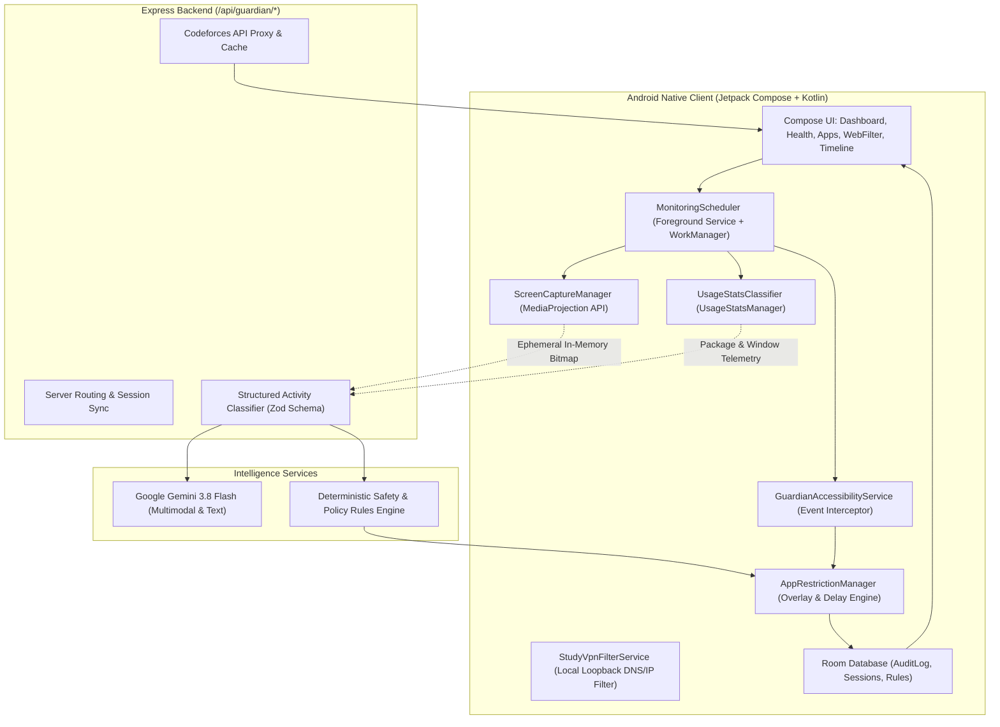

# ARCHITECTURE — AI DISCIPLINE GUARDIAN

**System:** CLIMB 1600 AI Discipline Guardian & Focus Companion  
**Stack:** Native Android (Kotlin + Jetpack Compose) + Node.js/Express Backend + Google Gemini LLM  
**Architecture Pattern:** Clean Architecture / MVI (Model-View-Intent) + Modular Service Abstractions  
**Version:** 1.0.0  

---

## 1. High-Level Architecture Overview

The **AI Discipline Guardian** is a personal, voluntary self-regulation system designed to help competitive programmers stay focused on deliberate algorithmic problem solving (Codeforces) while preventing digital distractions and exposure to explicit content.



---

## 2. Core Subsystems & Interfaces

### 2.1 Android Native Layer

1. **`MonitoringScheduler` (`service/GuardianForegroundService.kt` + `WorkManager`):**
   - Implements periodic scheduling with configurable intervals (default: 30 minutes for ordinary monitoring, 5 minutes for active hard-lock rechecks).
   - Manages a persistent foreground service with user-visible ongoing notifications, timer ticker, and immediate "Pause Monitoring" action button.
   - Respects user-configured quiet hours, battery-saver states, and network constraints (Wi-Fi vs Mobile data).

2. **`ScreenCaptureManager` (`service/ScreenCaptureManager.kt`):**
   - Encapsulates Android's `MediaProjection` API.
   - Operates strictly with explicit user consent tokens obtained via `createScreenCaptureIntent()`.
   - Produces ephemeral, in-memory `Bitmap` buffers. Never saves raw screenshot files to disk by default.
   - Enforces immediate teardown of `VirtualDisplay` and `ImageReader` upon analysis completion.

3. **`UsageStatsClassifier` (`classifier/UsageStatsClassifier.kt`):**
   - Queries `UsageStatsManager.queryEvents()` for foreground app transitions (`ACTIVITY_RESUMED`, `ACTIVITY_PAUSED`).
   - Normalizes usage intervals, filtering out sub-3-second app flickers.
   - Pre-classifies known package signatures into categories:
     - Essential communication (Dialer, Authenticator, SMS) -> *Whitelisted / Protected*
     - Competitive programming (Termux, CIDE, Codeforces app, Web browser on codeforces.com) -> *Productive*
     - Study / University (Canvas, Classroom, Google Docs) -> *Productive*
     - Social media / Entertainment (TikTok, Instagram, Facebook, Netflix) -> *Distraction Candidate*

4. **`GuardianAccessibilityService` (`service/GuardianAccessibilityService.kt`):**
   - Intercepts `TYPE_WINDOW_STATE_CHANGED` events with zero text-logging or keylogging.
   - Enforces emergency whitelist immunity (phone dialer, emergency SOS, 2FA authenticators are never blocked).
   - Launches `BlockingOverlayActivity` when a restricted app is launched during an active focus session.

5. **`AppRestrictionManager` & `BlockingOverlayActivity` (`ui/screens/BlockingOverlayActivity.kt`):**
   - Presents a gentle, reflective full-screen focus pause.
   - Displays configurable reflection delays (e.g., 15–60 seconds) with deep-breathing prompts.
   - Offers actionable escape routes:
     - *"Return to Codeforces Practice"* (launches active problem IDE)
     - *"I Am Studying / Necessary Task"* (logs explanation and allows one-time bypass)
     - *"Take a 5-Minute Break"* (scheduled pause)

6. **`StudyVpnFilterService` (`service/StudyVpnFilterService.kt`):**
   - High-performance, battery-friendly local `VpnService` running entirely on-device without external proxy servers.
   - Inspects outgoing DNS queries and blocks known distraction domains while permitting Codeforces, GitHub, Wikipedia, and academic resources.

7. **`AuditLogRepository` (`data/local/AppDatabase.kt`):**
   - Room SQLite persistence for audit logs, completed study sessions, app usage history, and custom user rules.

---

## 3. Backend & LLM Classifier Architecture

### 3.1 Structured Schema Protocol

The classifier endpoint (`POST /api/guardian/classify-activity`) implements strict JSON-schema validation using Zod:

```typescript
const ActivityClassificationSchema = z.object({
  category: z.enum([
    'competitive_programming',
    'programming_learning',
    'academic_study',
    'productive_work',
    'communication',
    'entertainment',
    'social_media',
    'potentially_explicit_content',
    'unknown',
  ]),
  confidence: z.number().min(0).max(1),
  evidence_summary: z.string().max(250),
  recommended_action: z.enum([
    'allow',
    'coach_nudge',
    'request_explanation',
    'apply_restriction',
    'hard_lock_trigger',
    'none',
  ]),
  policy_rule: z.string(),
  requires_user_confirmation: z.boolean(),
  screenshot_used: z.boolean(),
  analysis_timestamp: z.string(),
});
```

### 3.2 Dual Classification Pipeline

1. **Deterministic Rule Engine (On-Device / Fast Path):**
   - Instantly evaluates package identity and user-configured custom rules.
   - Whitelists phone calls, system settings, and CP IDEs in <10ms without network roundtrips.
2. **Multimodal LLM Engine (Cloud / Deep Path):**
   - Triggered only when cloud analysis is explicitly enabled in Settings and a valid screenshot buffer is provided.
   - Calls Google Gemini 3.8 Flash with specialized prompt engineering to distinguish genuine distraction from educational programming tutorials, while strictly identifying explicit content.
   - Zero-temperature deterministic output with fallback to `unknown` on network timeout or low confidence.

---

## 4. Policy Execution Flowcharts

### 4.1 Ordinary Distraction Flow

```mermaid
sequenceDiagram
    autonumber
    participant Dev as Android Device
    participant Guard as Guardian Scheduler
    participant Engine as Classifier & Policy Engine
    participant User as Student
    participant Over as Focus Overlay

    Guard->>Dev: Periodic check triggered (30 min)
    Guard->>Dev: Inspect foreground package & usage
    alt Screenshot permitted & enabled
        Guard->>Dev: Capture in-memory screenshot buffer
    else Screenshot unavailable
        Guard->>Dev: Use UsageStats telemetry only
    end
    Guard->>Engine: Send activity telemetry
    Engine->>Engine: Evaluate rules & classification
    alt Category is Distraction & Confidence >= Threshold
        Engine->>Guard: Propose restriction (requires confirmation)
        Guard->>User: Display Notification: "Distraction detected on [App]"
        Note over User,Guard: 60-second response window
        alt User supplies justification ("Studying / Necessary")
            User->>Guard: Submit explanation
            Guard->>Guard: Log explanation & bypass restriction
        else Window expires or User confirms return
            Guard->>Over: Present gentle Focus Overlay
            Over->>User: Offer "Return to Codeforces Practice"
        end
    else Category is Productive / Whitelisted
        Engine->>Guard: No action needed (log telemetry)
    end
```

### 4.2 Strict Explicit-Content Hard-Lock Flow

```mermaid
sequenceDiagram
    autonumber
    participant Dev as Android Device
    participant Engine as Classifier
    participant Guard as Guardian Service
    participant Over as Strict Overlay

    Dev->>Engine: Analyze screen capture
    alt High Confidence Explicit Content Detected & Hard-Lock Enabled
        Engine->>Guard: Trigger HARD_LOCK (Confidence > 0.90)
        Guard->>Guard: Record trigger (no raw sexual imagery stored)
        Guard->>Dev: Temporarily restrict foreground distracting app
        Guard->>Over: Present Urgent Focus Lockout
        Guard->>Guard: Schedule 5-Minute Recheck Timer
        loop Every 5 Minutes
            Guard->>Dev: Recheck screen & active package
            alt Content No Longer Present
                Guard->>Guard: Clear hard-lock & enter cooldown period
                Guard->>Over: Release lockout screen
            else Content Still Detected
                Guard->>Guard: Maintain restriction
            end
        end
    end
```
