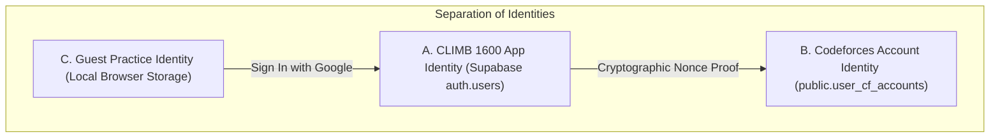

# CLIMB 1600 — Authentication & Codeforces Account Linking Architecture

**Target Audience:** Engineering, DevOps, QA, and Mobile Developers  
**System:** CLIMB 1600 (Competitive Programming Training Platform)  
**Version:** 1.0.0 (Production Architecture)

---

## 1. Authentication Architecture Overview

CLIMB 1600 strictly decouples three fundamental identities:

1. **CLIMB 1600 Application Identity:** An authenticated account in Supabase Auth (`auth.users`), authenticated via Google OAuth 2.0 (Web) or Android Credential Manager (Native). Stored in `public.profiles`.
2. **Codeforces Account Identity:** A verified public Codeforces handle tied to an authenticated CLIMB 1600 account through a server-validated, single-use cryptographic challenge. Stored in `public.user_cf_accounts`.
3. **Guest Practice Identity:** An ephemeral, local-only browsing and practice identity allowing unauthenticated visitors to solve problems, run code in the sandbox, and use the mistake notebook without creating an account. Stored exclusively in the browser's `localStorage`.



---

## 2. Guest Practice Capabilities & Limitations

### What Guest Users CAN Do:
- Browse the 11,481 indexed official Codeforces problems.
- Read problem statements, constraints, and tags.
- Write, test, and run code in the C++20/C++17/Python compiler sandbox (`/api/execute`).
- Receive graduated Socratic hints (Hint Level 1 to 5).
- Search and study 5,164 verified C++ solutions in the Solution Library.
- Store local practice attempts and mistake cards in browser `localStorage`.
- Perform public Codeforces handle lookups for inspection.

### Guest Limitations:
- Data is stored locally in `localStorage` on that specific device/browser. Clearing browser storage deletes local practice history.
- Cannot claim or officially verify Codeforces handle ownership.
- Cannot synchronize Codeforces rating graphs or live submissions to cloud databases.
- Multi-device sync and progress recovery are disabled.

### Guest-to-Account Migration:
When a guest chooses to sign in with Google:
1. Google OAuth flow completes and creates/loads their profile.
2. The frontend detects local practice attempts and mistakes in `localStorage`.
3. A migration dialog prompts: "Import Guest Practice Data?".
4. If accepted, `POST /api/auth/guest-migrate` safely upserts records into `public.user_practice_attempts` and `public.user_mistakes` with `ON CONFLICT DO NOTHING`, preventing duplicate records without overwriting existing cloud history.

---

## 3. Codeforces Handle Ownership Verification

### The Security Problem:
Merely checking that `https://codeforces.com/api/user.info?handles=tourist` returns 200 OK does **not** prove the person typing `tourist` owns that account. Anyone could claim a Grandmaster profile.

### The Solution: Server-Side Cryptographic Challenge:
1. **Initiation (`POST /api/codeforces/verify/initiate`):**
   - The user inputs their Codeforces handle.
   - The backend validates the handle format (`^[a-zA-Z0-9_.-]{3,24}$`).
   - The server queries Codeforces `user.info` to confirm the public profile exists.
   - The server checks if another user has already verified this handle (`uq_verified_cf_handle`).
   - The server generates an unpredictable single-use nonce: `CLIMB-<HEX>` (e.g. `CLIMB-7F8A3B2C`).
   - Stored in `public.cf_verification_challenges` with a strict 15-minute expiration timestamp and a maximum of 5 verification checks.
2. **User Publication:**
   - The user is directed to `https://codeforces.com/settings/social`.
   - The user temporarily pastes `CLIMB-<HEX>` into their **First Name**, **Last Name**, or **Organization** field and saves changes on Codeforces.
3. **Confirmation (`POST /api/codeforces/verify/confirm`):**
   - The backend queries Codeforces `user.info` with cache-busting directly.
   - The server checks `firstName`, `lastName`, `organization`, and `city` for the exact challenge code.
   - If matched:
     - The challenge is marked `consumed`.
     - `public.user_cf_accounts` is updated to `verification_status: 'verified'`.
     - Initial data synchronization runs.
     - The user is notified that they can now revert their Codeforces profile fields.
   - If not matched:
     - The attempt counter is incremented.
     - Actionable feedback is returned showing what values were found.
4. **Unlinking:**
   - A user can unlink their Codeforces account anytime (`POST /api/codeforces/unlink`).
   - Unlinking **never** deletes historical CLIMB 1600 practice attempts or mistakes.

---

## 4. Google OAuth Configuration Guide

### Web Application Setup:
1. **Google Cloud Console (`https://console.cloud.google.com`):**
   - Navigate to **APIs & Services > Credentials**.
   - Create an **OAuth 2.0 Client ID** of type **Web application**.
   - Under **Authorized redirect URIs**, add your Supabase Auth callback URL:
     ```text
     https://ptwrscbantaseijldwgt.supabase.co/auth/v1/callback
     ```
   - Copy the generated **Client ID** (e.g. `xxxxx-xxxx.apps.googleusercontent.com`) and **Client Secret**.

2. **Supabase Dashboard (`https://supabase.com/dashboard`):**
   - Go to **Authentication > Providers > Google**.
   - Toggle **Enable Sign in with Google** to **ON**.
   - In **Client IDs**, enter your Google OAuth Web Client ID (ending in `.apps.googleusercontent.com`).
     *(Note: Do not enter the project name or email; enter the exact Client ID string).*
   - In **Client Secret (for OAuth)**, paste your client secret.
   - Under **URL Configuration**, ensure Site URL is `http://localhost:3000` (or production domain) and Redirect URLs include `http://localhost:3000/**`.
   - Click **Save**.

### Native Android Setup:
1. **Google Cloud Console:**
   - In the same project, create another OAuth 2.0 Client ID of type **Android**.
   - Package name: `com.climb1600.companion`
   - SHA-1 certificate fingerprint:
     - For debug builds: obtain using:
       ```bash
       keytool -list -v -keystore ~/.android/debug.keystore -alias androiddebugkey -storepass android -keypass android
       ```
2. **Native Credential Manager Flow:**
   - Android app uses `androidx.credentials` + `GoogleIdTokenCredential`.
   - Requests ID token with `serverClientId = <Web Client ID>`.
   - Directly exchanges ID token with Supabase via `POST /auth/v1/token?grant_type=id_token`.
   - Zero browser popups or redirects on native Android.

---

## 5. Database Schema & RLS Policies

The database migration is located in `supabase/migrations/20261030_auth_and_codeforces_linking.sql`:

- `public.profiles`: Application identity, settings, streak, current day.
- `public.user_cf_accounts`: Linked Codeforces account, verification status, rating, max rating, solved count. Unique index on `normalized_handle` for verified accounts.
- `public.cf_verification_challenges`: Cryptographic challenge tokens with expiration and attempt limiting.
- `public.user_practice_attempts`: Cloud sync of problem attempts.
- `public.user_mistakes`: Cloud sync of mistake cards and spaced repetition intervals.

### Row Level Security (RLS) Rules:
- Authenticated users can read and update only their own profile (`auth.uid() = id`).
- Authenticated users can read their own `user_cf_accounts`, but cannot modify `verification_status` directly.
- Challenge generation and verification status changes occur exclusively via backend Express endpoints using the secure `service_role` key.

---

## 6. Environment Variables Reference

| Variable Name | Environment | Description |
|---|---|---|
| `PORT` | Backend | Port number for Express server (default `3000`) |
| `SUPABASE_URL` | Backend / Frontend | Supabase project URL (`https://ptwrscbantaseijldwgt.supabase.co`) |
| `SUPABASE_PROJECT_ID` | Backend | Supabase project reference (`ptwrscbantaseijldwgt`) |
| `SUPABASE_ANON_KEY` | Backend | Public anonymous Supabase key |
| `SUPABASE_SERVICE_ROLE_KEY` | Backend Only | Secret admin service-role key (NEVER expose to client) |
| `SUPABASE_ACCESS_TOKEN` | Tooling / Migrations | Management API access token for programmatic schema migrations |
| `VITE_SUPABASE_URL` | Frontend (Vite) | Exposed to browser for client-side Supabase client |
| `VITE_SUPABASE_ANON_KEY` | Frontend (Vite) | Exposed to browser for client-side Supabase client |
| `VITE_GOOGLE_CLIENT_ID` | Frontend / Android | Web Client ID ending in `.apps.googleusercontent.com` |
| `GEMINI_API_KEY` | Backend | Google GenAI API key for AI Coach and submissions autopsy |
