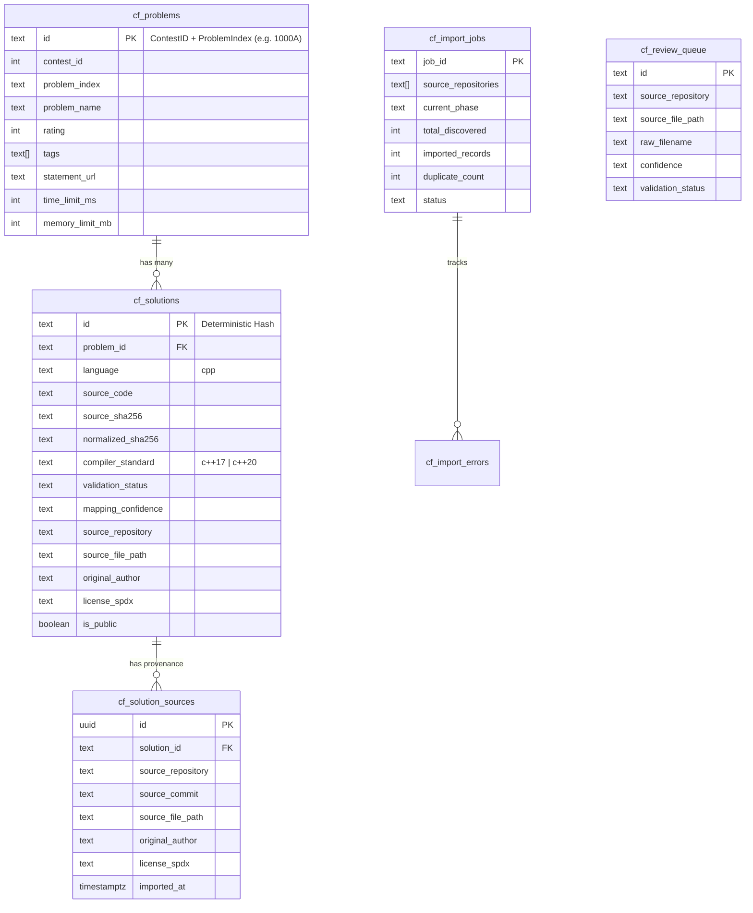

# DATABASE SCHEMA & STORAGE ARCHITECTURE

**System:** CLIMB 1600 Codeforces Solution Engine  
**Target Engine:** Supabase PostgreSQL 14+  
**Migration File:** `supabase/migrations/20261029_codeforces_engine.sql`

---

## 1. Schema Overview & Entity-Relationship Design

---

## 2. Table Specifications

### `public.cf_problems`
Holds official Codeforces problem metadata retrieved from Codeforces API.
- `id` (TEXT, PK): Unique composite identifier (e.g. `1000A`, `4B`, `1613C`).
- `contest_id` (INT, NOT NULL): Official contest number.
- `problem_index` (TEXT, NOT NULL): Letter index (`A`, `B`, `C1`, etc.).
- `problem_name` (TEXT, NOT NULL): Problem title.
- `rating` (INT, NULLABLE): Official Codeforces difficulty rating (800–3500).
- `tags` (TEXT[], DEFAULT '{}'): Algorithmic tags (e.g. `['dp', 'greedy', 'sortings']`).
- `statement_url` (TEXT): Official problem statement link.
- `time_limit_ms` (INT, DEFAULT 1000): Time limit in milliseconds.
- `memory_limit_mb` (INT, DEFAULT 256): Memory limit in megabytes.

### `public.cf_solutions`
Holds curated, deduplicated, validated reference C++ solutions.
- `id` (TEXT, PK): Deterministic 32-character SHA-256 hash derived from `${problem_id}_${source_sha256}`.
- `problem_id` (TEXT, FK -> `cf_problems.id`): Associated problem.
- `language` (TEXT, DEFAULT 'cpp'): Language identifier.
- `source_code` (TEXT, NOT NULL): Preserved raw C++ source code with original author headers.
- `source_sha256` (TEXT, NOT NULL): Exact cryptographic hash of file bytes.
- `normalized_sha256` (TEXT, NOT NULL): Normalized AST/whitespace hash for duplicate detection.
- `compiler_standard` (TEXT, DEFAULT 'c++17'): Detected or target compiler standard.
- `validation_status` (TEXT): Current test status (`source_checked`, `compiled`, `needs_review`, `rejected`).
- `mapping_confidence` (TEXT): Match quality (`high`, `medium`, `low`, `unmatched`).
- `source_repository` (TEXT): Origin repository (`owner/repo`).
- `source_file_path` (TEXT): Original path within repository.
- `source_commit` (TEXT): Origin commit SHA.
- `original_author` (TEXT): Identified original author.
- `license_spdx` (TEXT): Permissive license identifier (`MIT`, `Apache-2.0`).
- `is_public` (BOOLEAN, DEFAULT true): Whether visible in the public student catalog.

### `public.cf_solution_sources`
Tracks multi-repository provenance when the identical solution exists in multiple open-source repositories.
- `id` (UUID, PK)
- `solution_id` (TEXT, FK -> `cf_solutions.id`)
- `source_repository`, `source_file_path`, `source_commit`, `original_author`, `license_spdx`

### `public.cf_import_jobs` & `cf_import_errors`
Maintains a verifiable ledger of ingestion operations, batch progress, checkpoints, and failure diagnostics.

### `public.cf_review_queue`
Stores files where problem mapping or C++ structure requires human or administrative review.

---

## 3. Query Optimization & Indexing Rationale

To ensure optimal performance under Supabase free/low-cost tiers:
1. **Search queries project only metadata:** The UI listing queries `id`, `problem_id`, `language`, `compiler_standard`, `validation_status`, `original_author`, and `license_spdx`. The heavy `source_code` column is loaded only on demand when a user clicks to view or compare a specific solution.
2. **Compound Index on Problem Identifier:** `uq_cf_problems_contest_index` provides instantaneous $O(1)$ lookups for contest/index queries.
3. **GIN Index on Tags:** Enables efficient array filtering (`tags @> ARRAY['dp']`) across thousands of problems.
4. **B-Tree Indexes on Ratings & Status:** Accelerates difficulty band filtering (`rating >= 800 AND rating <= 1600`).
